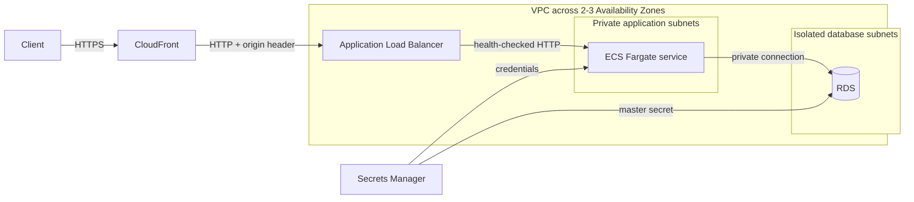

# Architecture

DeployKit creates one CloudFormation stack with a public edge and load-balancing layer, private stateless compute, and an isolated stateful tier.

## Request path

1. CloudFront redirects viewers to HTTPS and forwards dynamic requests without caching by default.
2. The ALB security group accepts port 80 only from the AWS-managed CloudFront origin-facing prefix list.
3. CloudFront adds a generated origin header. The listener returns `403` unless that header matches.
4. The target group sends healthy requests to Fargate tasks in private subnets.
5. Only the ECS service security group can reach the RDS port.

The origin connection uses HTTP inside the CloudFront-to-ALB path. Network prefix-list filtering and the generated header protect the public ALB endpoint. Teams that require encryption on the origin hop should add an ALB certificate and set the CloudFront origin policy to HTTPS-only.

## Deployment lifecycle

`deploykit deploy` validates the config, synthesizes the stack through the CDK app, checks the environment bootstrap stack, publishes the local Docker build as a CDK asset, and deploys CloudFormation.

For `prod` and `production` stages, DeployKit turns on stack termination protection, RDS deletion protection, Multi-AZ, seven-day backups, and retain policies for database state and application logs.
